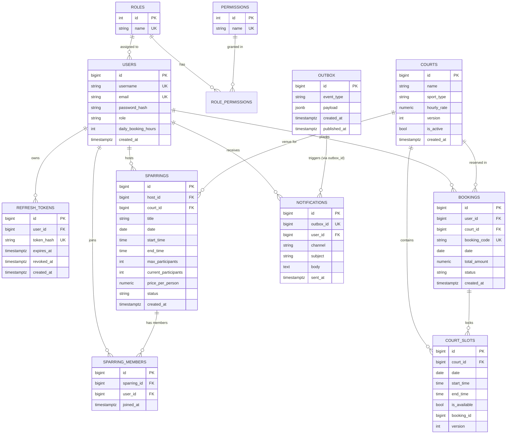

# SOP & PANDUAN PENGEMBANGAN TIM — COURTMASTER
## Single Source of Truth (SSOT) Arsitektur, Skema Basis Data, API & Git Workflow

Dokumen ini merupakan **Standard Operating Procedure (SOP)** dan panduan arsitektur resmi untuk tim pengembang backend **CourtMaster** (3 orang). Setiap anggota wajib memahami dan mematuhi panduan ini agar kolaborasi kode di GitHub berjalan lancar, terhindar dari konflik besar, dan memenuhi seluruh kriteria penilaian perkuliahan (termasuk penilaian keaktifan dan dampak *micro-commits*).

---

## 1. Prinsip Utama Arsitektur (Simplified Clean Architecture)

Sesuai kesepakatan pada **Modul 4**, proyek ini menggunakan varian Clean Architecture yang disederhanakan untuk ekosistem Go dan Fiber v2. 

> [!CAUTION]
> **ATURAN MUTLAK PERKULIAHAN:**
> 1. **Dilarang keras** membuat direktori bernama `controller/` atau `handler/`!
> 2. Penanganan request HTTP langsung menjadi method pada struct Service di dalam `app/service/*_service.go`.
> 3. Logika bisnis murni (validasi domain, kalkulasi tarif, proteksi kuota) **wajib diisolasi** di file `app/service/*_rules.go` tanpa mengimpor package Fiber (`*fiber.Ctx`) maupun driver database.
> 4. Layer `app/repository/` **hanya menerima interface `DBTX`** (`Exec`, `Query`, `QueryRow`) dan **dilarang mengimpor package Fiber**.
> 5. Service dilarang memuat kueri SQL mentah; semua interaksi SQL wajib melalui Repository interface.

### Diagram Aliran Dependensi

```
[ HTTP Request ]
       │
       ▼
[ app/route ] ────────► Mendaftarkan route dan middleware ke Fiber App
       │
       ▼
[ app/service/*_service.go ] ───► Menerima *fiber.Ctx, parsing body/params, memanggil rules
       │                    │
       │                    ▼
       │         [ app/service/*_rules.go ] (Pure business logic, 100% testable)
       ▼
[ app/repository/*_repository.go ] ──► Menerima interface DBTX, eksekusi query/exec SQL
       │
       ▼
[ Database (PostgreSQL / MongoDB) ]
```

---

## 2. Skema Basis Data & Desain Tabel (Polyglot Persistence)

Sistem menggunakan dua basis data yang saling melengkapi:
- **PostgreSQL 16**: Basis data relasional transaksional ACID untuk otentikasi, perizinan, data gelanggang, slot jam, reservasi, sesi mabar, dan *transactional outbox*.
- **MongoDB 7.0**: Basis data dokumen NoSQL untuk ulasan gelanggang (*social counter* dan rating) dengan pemanfaatan *atomic update operators* dan *Aggregation Pipeline*.

### 2.1 Diagram Relasi Entitas Relasional (ERD PostgreSQL)



### 2.2 Rincian Tabel Relasional (PostgreSQL)

| No | Nama Tabel | Pemilik Fitur | Fungsi Utama & Integritas Data |
| :---: | :--- | :---: | :--- |
| 1 | `roles` | Anggota 1 | Master role pengguna (`admin`, `manager`, `player`). |
| 2 | `permissions` | Anggota 1 | Master hak akses granular (`court:create`, `booking:read`, `queue:monitor`, dll). |
| 3 | `role_permissions` | Anggota 1 | Pivot mapping hak akses peran (Many-to-Many). |
| 4 | `users` | Anggota 2 | Menyimpan data akun, hash Bcrypt cost 12, dan akumulasi `daily_booking_hours`. |
| 5 | `refresh_tokens` | Anggota 2 | Token rotasi (hash SHA-256) dengan penanda pencabutan `revoked_at TIMESTAMPTZ`. |
| 6 | `courts` | Anggota 1 | Master arena olahraga dengan kolom `version` untuk *Optimistic Locking* (Modul 9). |
| 7 | `court_slots` | Anggota 1 | Slot jam operasional (06:00-24:00) dengan constraint unik `(court_id, date, start_time)`. |
| 8 | `bookings` | Anggota 3 | Transaksi reservasi lapangan dengan kode unik `booking_code` dan total biaya sewa. |
| 9 | `sparrings` | Anggota 3 | Sesi mabar publik dengan counter atomik `current_participants < max_participants`. |
| 10| `sparring_members`| Anggota 3 | Pivot peserta sesi mabar dengan constraint unik `(sparring_id, user_id)`. |
| 11| `outbox` | Anggota 3 | Pencatatan event asinkron di dalam transaksi ACID. Menggunakan partial index `WHERE published_at IS NULL`. |
| 12| `notifications` | Anggota 3 | Rekam jejak notifikasi terkirim. Kolom `outbox_id` berstatus `UNIQUE` (*idempotency key* Modul 11). |

### 2.3 Skema Dokumen NoSQL (MongoDB `court_reviews`)

Koleksi `court_reviews` dikelola oleh **Anggota 2** untuk menampung ulasan fleksibel dan interaksi sosial:

```json
{
  "_id": ObjectId("664a1b89ef123456789abcde"),
  "court_id": NumberLong(1),
  "user_id": NumberLong(10),
  "rating": 5,
  "comment": "Lantai vinyl sangat empuk dan lampu penerangan anti-glare sangat terang!",
  "tags": ["lampu-terang", "lantai-bersih", "parkir-luas"],
  "helpful_by": [NumberLong(2), NumberLong(5)],
  "replies": [
    {
      "user_id": NumberLong(3),
      "user_name": "Manager Central Arena",
      "comment": "Terima kasih atas ulasannya kak! Ditunggu kedatangannya kembali.",
      "created_at": ISODate("2026-11-17T08:30:00Z")
    }
  ],
  "created_at": ISODate("2026-11-17T08:00:00Z")
}
```

* **Indeks Wajib (Modul 10):**
  1. `db.court_reviews.createIndex({ court_id: 1, user_id: 1 }, { unique: true })` -> Memastikan 1 pemain hanya boleh memberi 1 ulasan per gelanggang.
  2. `db.court_reviews.createIndex({ court_id: 1, tags: 1 })` -> Multikey index untuk pencarian cepat berdasarkan tag ulasan.

---

## 3. Matriks Peta Endpoint API (API Route Map)

Seluruh route menggunakan awalan `/api/v1` dan menyajikan dokumentasi interaktif Swagger UI pada `/swagger/index.html`.

| Metode | Endpoint URL | Auth | Permission | Penanggung Jawab | Deskripsi Singkat |
| :---: | :--- | :---: | :---: | :---: | :--- |
| `POST` | `/api/v1/auth/register` | Publik | - | Anggota 2 | Registrasi pemain/manager baru (Bcrypt cost 12). |
| `POST` | `/api/v1/auth/login` | Publik | - | Anggota 2 | Login dengan IP rate limiter (5 req/m), issue JWT & Refresh. |
| `POST` | `/api/v1/auth/refresh` | Publik | - | Anggota 2 | Rotasi refresh token SHA-256 (masa aktif 7 hari). |
| `POST` | `/api/v1/auth/logout` | Bearer | - | Anggota 2 | Mencabut token refresh aktif (`revoked_at = NOW()`). |
| `GET` | `/api/v1/courts` | Publik | - | Anggota 1 | Katalog arena olahraga, filter `sport_type`. |
| `GET` | `/api/v1/courts/:id/slots` | Publik | - | Anggota 1 | Jadwal slot jam operasional (`date=YYYY-MM-DD`). |
| `POST` | `/api/v1/courts` | Bearer | `court:create` | Anggota 1 | Menambah data arena gelanggang baru. |
| `PATCH`| `/api/v1/courts/:id` | Bearer | `court:manage` | Anggota 1 | Update tarif sewa dengan *Optimistic Lock* (`version`). |
| `POST` | `/api/v1/bookings` | Bearer | `booking:create`| Anggota 3 | Booking slot jam: ACID `WithTx` + Atomic update + Outbox. |
| `GET` | `/api/v1/bookings` | Bearer | `booking:read` | Anggota 3 | Riwayat sewa pemain dengan Keyset Cursor Pagination. |
| `POST` | `/api/v1/bookings/swap` | Bearer | `booking:update`| Anggota 3 | Tukar slot jam bebas *deadlock* (urutan lock ID terurut). |
| `GET` | `/api/v1/bookings/export` | Bearer | `booking:export`| Anggota 3 | Negosiasi konten: unduh riwayat format JSON atau CSV RFC 4180. |
| `POST` | `/api/v1/sparrings` | Bearer | `sparring:create`| Anggota 3 | Buat sesi mabar komunitas publik. |
| `GET` | `/api/v1/sparrings` | Publik | - | Anggota 3 | Daftar sesi mabar aktif yang memiliki sisa kuota. |
| `POST` | `/api/v1/sparrings/:id/join` | Bearer| `sparring:join`| Anggota 3 | Gabung mabar via atomic conditional UPDATE kuota peserta. |
| `POST` | `/api/v1/courts/:id/reviews`| Bearer | `review:create`| Anggota 2 | Simpan ulasan ke MongoDB (verifikasi riwayat sewa di SQL). |
| `GET` | `/api/v1/courts/:id/reviews`| Publik | - | Anggota 2 | Feed ulasan dengan kursor ObjectID `before` & filter tag. |
| `GET` | `/api/v1/courts/:id/reviews/summary`| Publik| - | Anggota 2 | *Aggregation Pipeline* MongoDB: rata-rata bintang & top 5 tag. |
| `POST` | `/api/v1/reviews/:id/helpful`| Bearer| - | Anggota 2 | Atomic `$addToSet` + `$inc` vote bermanfaat (anti-self-vote). |
| `POST` | `/api/v1/reviews/:id/replies`| Bearer| - | Anggota 2 | Balasan ulasan via `$push` atomik (dibatasi max 50 balasan). |
| `GET` | `/api/v1/notifications` | Bearer | - | Anggota 3 | Melihat daftar notifikasi pengguna login urut tanggal kirim terbaru. |
| `POST` | `/api/v1/notifications/outbox/retry` | Bearer | `outbox:manage` | Anggota 3 | Trigger manual relay event outbox yang tertunda (khusus Admin). |
| `GET` | `/api/v1/admin/queue` | Bearer | `queue:monitor`| Anggota 3 | Monitoring statistik Asynq Redis dan antrean outbox SQL. |

---

## 4. Standar Coding & Convention

### 4.1 Response Envelope Baku (`WebResponse`)
Seluruh handler Fiber wajib mengembalikan respons dalam format envelope seragam (Modul 2, 4 & acuan `api-students`):

```json
{
  "success": true,
  "message": "daftar gelanggang berhasil diambil",
  "data": { ... },
  "meta": {
    "limit": 10,
    "next_cursor": "eyJjcmVhdGVkX2F0Ijoi...",
    "has_more": true
  }
}
```

Bila terjadi error:
```json
{
  "success": false,
  "message": "Slot waktu yang dipilih telah dipesan oleh pemain lain",
  "errors": {
    "field": "detail error validasi"
  }
}
```

Gunakan helper response sukses resmi:
- `helper.Success(c, fiber.StatusOK, "pesan", data)`
- `helper.Created(c, "pesan", data, location)`
- `helper.SuccessList(c, "pesan", data, meta)`
- `helper.SuccessCursor(c, "pesan", data, cursorMeta)`
- `helper.NoContent(c)`

Untuk error, return helper error (`*helper.AppError`) yang ditangani otomatis oleh centralized ErrorHandler di `config/app.go`:
- `return helper.BadRequest("pesan")`
- `return helper.Unauthorized("pesan")`
- `return helper.Forbidden("pesan")`
- `return helper.NotFound("pesan")`
- `return helper.Conflict("pesan")`
- `return helper.Validation(errsMap)`
- `return helper.Internal(err)`

### 4.2 Centralized Error Handling (`AppError`)
Dilarang me-return raw status code acak dari dalam repository. Gunakan sentinel error di repository:
- `var ErrNotFound = errors.New("record not found")`
- `var ErrDuplicate = errors.New("record already exists")`
- `var ErrConflict = errors.New("resource conflict")`

Lalu di layer Service, petakan ke factory error `helper`:
```go
if errors.Is(err, repository.ErrNotFound) {
    return helper.NotFound("Gelanggang tidak ditemukan")
}
if errors.Is(err, repository.ErrDuplicate) {
    return helper.Conflict("Data sudah terdaftar")
}
```

---

## 5. Kamus Variabel Lingkungan Baku (`.env.example`)

Setiap anggota tim wajib memiliki file `.env` lokal yang memuat variabel berikut:

| Variabel | Nilai Default Lokal | Modul | Keterangan |
| :--- | :--- | :---: | :--- |
| `APP_PORT` | `8080` | Modul 1 | Port aplikasi server HTTP Fiber. |
| `APP_NAME` | `"CourtMaster Backend API"` | Modul 4 | Nama aplikasi yang ditampilkan di header/log. |
| `LOG_LEVEL` | `info` | Modul 4 | Tingkat level logging slog (`debug`, `info`, `warn`, `error`). |
| `ALLOWED_ORIGINS` | `http://localhost:5173` | Modul 5 | Whitelist CORS domain frontend (React/Vite). |
| `DB_HOST` | `localhost` (atau `postgres` di docker) | Modul 3 | Host PostgreSQL server. |
| `DB_PORT` | `5432` | Modul 3 | Port PostgreSQL. |
| `DB_USER` | `courtmaster` | Modul 3 | Username PostgreSQL. |
| `DB_PASSWORD` | `secret` | Modul 3 | Password PostgreSQL. |
| `DB_NAME` | `courtmaster_db` | Modul 3 | Nama database operasional. |
| `DB_SSLMODE` | `disable` | Modul 3 | Mode enkripsi koneksi SSL. |
| `DB_MAX_CONNS` | `10` | Modul 3 | Batas maksimal koneksi connection pool `pgxpool`. |
| `MONGO_URI` | `mongodb://localhost:27017` | Modul 10| URI koneksi MongoDB. |
| `MONGO_DATABASE` | `courtmaster_mongo` | Modul 10| Nama database NoSQL MongoDB. |
| `MONGO_MAX_POOL` | `20` | Modul 10| Batas maksimal koneksi connection pool MongoDB. |
| `JWT_SECRET` | `supersecretkey_courtmaster_min32chars` | Modul 5 | Kunci privat HMAC SHA-256 (minimal 32 karakter). |
| `JWT_ISSUER` | `courtmaster-backend` | Modul 5 | Identitas penerbit token. |
| `JWT_ACCESS_TTL_MINUTES` | `15` | Modul 5 | Masa berlaku Access Token (15 menit). |
| `JWT_REFRESH_TTL_DAYS` | `7` | Modul 5 | Masa berlaku Refresh Token (7 hari). |
| `REDIS_ADDR` | `localhost:6379` | Modul 11| Alamat broker Redis untuk task queue Asynq. |
| `REDIS_PASSWORD` | *(kosong)* | Modul 11| Password autentikasi Redis broker (jika ada). |
| `REDIS_DB` | `0` | Modul 11| Database index Redis (default 0). |
| `WORKER_CONCURRENCY` | `5` | Modul 11| Jumlah konkurensi goroutine worker Asynq. |
| `RELAY_INTERVAL_MS` | `2000` | Modul 11| Interval polling outbox relay (dalam milidetik). |
| `RELAY_BATCH` | `50` | Modul 11| Batas jumlah event per tarikan batch relay outbox. |
| `SWAGGER_ENABLED` | `true` | Modul 12| Menyalakan endpoint `/swagger/index.html`. |

---

## 6. Alur Kerja Git & Tahapan Integrasi Tim (Sprint Stages)

Sistem pengerjaan menggunakan prinsip **Foundation Freeze** di Tahap 0 dan **Pola Integrasi Rute Terpusat (Opsi B)**:

```
[ STAGE 0 - Foundation Freeze ]
Anggota 1 (Git Master):
- Setup go.mod (seluruh dependencies Modul 1-12 diunduh)
- Folder helper/ LENGKAP 100%, config/, database/ pgx & mongo
- Migrasi modular 001_roles... dan 002_users...
Push ke branch `develop` (SEMUA ANGGOTA UNBLOCKED!)
       │
       ├─────────────────────────┬─────────────────────────┐
       ▼                         ▼                         ▼
[ STAGE 1 - Paralel ]     [ STAGE 1 - Paralel ]     [ STAGE 1 - Paralel ]
Anggota 1:                Anggota 2:                Anggota 3:
Branch                    Branch                    Branch
`feat/court-management`   `feat/auth-rbac`          `feat/booking-reservation`
- DDL 003 courts & slots  - DDL 004 refresh_tokens  - DDL 005 bookings/spar
- Optimistic Locking      - Login & Rate Limiter    - ACID WithTx Booking
- Unit test rules         - Middleware RBAC         - Keyset & CSV Export
Buka PR #1                Buka PR #2                Buka PR #3
       │                         │                         │
       └─────────────────────────┼─────────────────────────┘
                                 │
                 (Review & Merge PR #1, #2, #3 ke develop)
                                 │
       ┌─────────────────────────┴─────────────────────────┐
       ▼                                                   ▼
[ STAGE 1.5 - Paralel Fitur 2 ]             [ STAGE 1.5 - Paralel Fitur 2 ]
Anggota 2:                                  Anggota 3:
Branch `feat/court-reviews`                 Branch `feat/outbox-worker`
- MongoDB CourtReview Repo                  - DDL 006 outbox & notif
- Atomic $push, $addToSet                   - Asynq Relay & Worker
- Aggregation Pipeline rating               - Dual-process worker.go
Buka PR #4                                  Buka PR #5
       │                                                   │
       └─────────────────────────┬─────────────────────────┘
                                 │
                                 ▼
[ STAGE 2 - Integrasi & Route Wiring (Opsi B) ]
Anggota 1 (Git Master):
- Mereview & me-merge PR #4 dan PR #5 ke `develop`.
- Menyambungkan seluruh service ke file tunggal `route/route.go` dan `main.go`.
- Mengkonfigurasi multi-stage `Dockerfile` dan `docker-compose.yml`.
                                 │
                                 ▼
[ STAGE 3 - Verifikasi & Finalisasi ]
Uji menyeluruh bersama: Unit test (`go test ./...`), E2E Postman, dan `docker compose up --build`.
Release branch `develop` -> `main` (Tag: `v1.0.0`).
```

### Aturan Micro-Commits (Conventional Commits)
Gunakan format standar: `<type>(<scope>): <deskripsi singkat imperative>`
- `feat(court): implement optimistic locking on update rate`
- `feat(auth): implement bcrypt cost 12 with dummy hash`
- `feat(booking): add atomic conditional update for court slots`
- `test(booking): add concurrency test with goroutines`
- `chore(devops): configure multi-stage Dockerfile and compose`

---

## 7. Data Awal Pengujian (Default Seed Data)

Untuk memastikan pengujian lokal dan review kode antar-anggota berjalan konsisten, gunakan akun seed berikut:

| Role | Username | Email | Password Plaintext | Hak Akses Utama |
| :---: | :--- | :--- | :--- | :--- |
| **Admin** | `admin` | `admin@courtmaster.id` | `AdminMaster2026` | `court:manage`, `queue:monitor`, `review:moderate` |
| **Manager** | `manager_central` | `manager@courtmaster.id` | `ManagerPadel123` | `court:create`, `court:manage` |
| **Player 1** | `player_budi` | `budi@gmail.com` | `BudiMainPadel2026` | `booking:create`, `booking:read`, `sparring:join` |
| **Player 2** | `player_sari` | `sari@gmail.com` | `SariBadminton2026` | `booking:create`, `booking:read`, `sparring:join` |

---

## 8. Checklist Kelulusan Tugas (Definition of Done)

Sebelum memfinalisasi repositori GitHub untuk penilaian dosen:
- [ ] Seluruh tabel PostgreSQL terbuat via migrasi `001_` s.d. `006_` dan berhasil di-seed.
- [ ] Database MongoDB terhubung dan koleksi `court_reviews` memiliki indeks compound unique & multikey.
- [ ] Seluruh endpoint REST API terdokumentasi dan dapat diuji melalui Swagger UI (`http://localhost:8080/swagger/index.html`).
- [ ] Transaksi ACID dan Concurrency Lock (Atomic UPDATE + FOR UPDATE) terbukti lolos uji race condition tanpa tabrakan slot.
- [ ] Outbox background worker Asynq berhasil memproses notifikasi tiket secara asinkron tanpa *dual-write*.
- [ ] Seluruh unit test dan fake repository test passing (`go test ./... -v`).
- [ ] Sistem dapat dijalankan secara instan dengan 1 perintah: `docker compose up --build`.
- [ ] Riwayat commit di GitHub membuktikan keaktifan *micro-commits* dari ketiga akun anggota tim.
